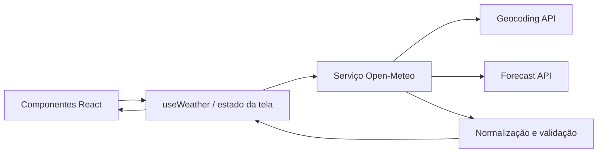
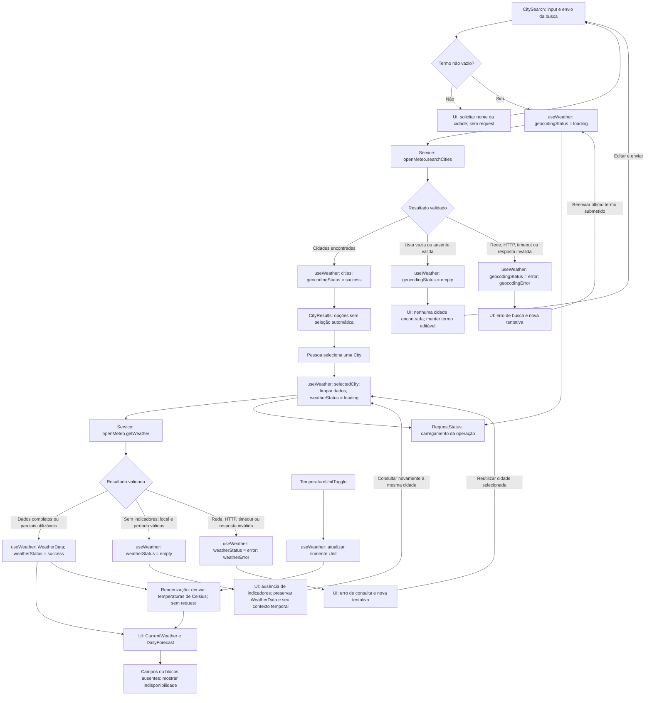

# Plano Técnico: Weather App

Este plano deriva de [`specs/weather-app-spec.md`](../specs/weather-app-spec.md). Define arquitetura, contratos e estratégia de validação; não implementa a aplicação. A estrutura `src/` ainda não existe no repositório, portanto a estrutura abaixo é proposta.

A próxima fase é gerar o backlog em `tasks/`, rastreável à spec e a este plano. Implementar somente após existirem as tarefas correspondentes, preservando o fluxo Spec → Plan → Tasks → Code → Test → Review.

## Architecture

Aplicação SPA no navegador, sem backend próprio. A UI React chama serviços de domínio, que encapsulam a comunicação HTTP com a Open-Meteo e convertem a resposta externa para tipos internos. Componentes recebem dados já normalizados e não conhecem nomes de campos do provedor.



Responsabilidades:

- **UI:** busca, seleção explícita de cidade, estados de carregamento/erro/vazio, clima atual, previsão diária e seletor de unidade.
- **Hook/estado da tela:** coordena busca e consulta, evita resultados de requisições antigas e mantém o estado da experiência.
- **Serviço:** constrói URLs, executa `fetch`, verifica HTTP/JSON e converte respostas para os contratos de domínio.
- **Utilitários puros:** conversão de temperatura, mapeamento de códigos meteorológicos e formatação por locale/fuso horário.

As dependências são unidirecionais: `App` compõe componentes e hook; o hook chama o serviço; o serviço acessa a API. Componentes, hook e serviço podem usar funções puras de `lib/` e contratos de `types/`. Serviços e funções puras não dependem de React.

- Componentes recebem dados e callbacks por props; podem manter estado estritamente visual, mas não interpretam JSON nem executam `fetch`.
- O hook decide **quando consultar**, mantém os estados do fluxo e coordena cancelamentos; não conhece campos externos como `temperature_2m`.
- O serviço decide **como consultar e normalizar**. Tipos brutos e mapeadores específicos do provedor ficam próximos ao serviço, inicialmente no mesmo arquivo.
- `lib/` recebe valores e retorna resultados, sem rede, DOM ou estado React. Locale, fuso e instante de referência são argumentos explícitos quando necessários, sem dependência implícita do relógio.

## Tech Stack

| Área | Decisão | Motivo |
|---|---|---|
| UI | React 19 + TypeScript strict + Vite | Stack existente no repositório e definida pela spec do projeto. |
| Estilo | Tailwind CSS, tema dark glassmorphism | Convenção do projeto; painéis translúcidos sobre fundo escuro, sem comprometer contraste e legibilidade. |
| HTTP | `fetch` nativo + `AbortController` | Uma integração REST simples não justifica adicionar cliente HTTP. |
| Estado | `useReducer` local à experiência de consulta | Agrupa transições relacionadas de busca, cidade e dados sem store global. |
| Formatação | `Intl.NumberFormat` e `Intl.DateTimeFormat` | Suporta locale do dispositivo e fuso da cidade sem dependência adicional. |
| Testes | Vitest, Testing Library, Playwright | Ferramentas já configuradas no projeto. |
| Qualidade | Biome | Lint e formatação já configurados. |

Não adicionar biblioteca de cache, store global, cliente HTTP ou camada genérica de repositório neste escopo.

O tema deve manter texto legível sobre todos os fundos, foco visível e estados distinguíveis sem depender apenas de cor. Ajustar opacidade e oferecer fundo sólido quando necessário; validar contraste WCAG 2.2 AA, inclusive em mensagens, controles e painéis com blur.

## Project Structure

Estrutura proposta, alinhada às convenções do repositório:

```text
src/
  main.tsx
  app/
    App.tsx
  components/
    CitySearch.tsx
    CityResults.tsx
    CurrentWeather.tsx
    DailyForecast.tsx
    TemperatureUnitToggle.tsx
    RequestStatus.tsx
  hooks/
    useWeather.ts
  services/
    openMeteo.ts
  types/
    weather.ts
  lib/
    temperature.ts
    weatherFormat.ts
    weatherCodes.ts
  index.css
```

- `main.tsx`: inicializa React e importa o estilo global.
- `App.tsx`: conecta o hook aos componentes e compõe a experiência, sem concentrar regras de negócio.
- `components/`: apresentação e interação acessível, sem chamadas HTTP. `CitySearch` captura a busca; `CityResults` oferece seleção explícita; `CurrentWeather` e `DailyForecast` apresentam indicadores; `TemperatureUnitToggle` altera a unidade; `RequestStatus` apresenta carregamento, vazio e erro com ação de nova tentativa.
- `useWeather.ts`: estado e ações da busca/consulta, seleção, unidade, nova tentativa e proteção contra respostas antigas.
- `openMeteo.ts`: endpoints, parsing, validação e mapeamento para tipos internos.
- `weather.ts`: contratos de domínio compartilhados.
- `temperature.ts`: conversão de Celsius para a unidade escolhida, sem alterar ou arredondar os valores armazenados.
- `weatherFormat.ts`: formatação numérica e de datas com locale e fuso explícitos.
- `weatherCodes.ts`: mapeamento de códigos WMO para rótulos pt-BR e chaves de ícone, com fallback.
- `index.css`: estilos globais e integração com Tailwind.

Usar `lib/` no lugar de `utils/` concentra as funções puras solicitadas sem manter duas pastas equivalentes. Parsing e validação específicos da Open-Meteo continuam em `services/`, não em uma biblioteca genérica.

## Data Model

Contratos de domínio. Campos meteorológicos que podem faltar na resposta são representados como `null`; não converter ausência em zero.

```ts
/** Unidade de temperatura escolhida para exibição. */
export type Unit = 'celsius' | 'fahrenheit';

export interface City {
  id: number; // Identificador do resultado de geocoding.
  name: string; // Nome da cidade.
  admin1: string | null; // Estado ou região, quando disponível.
  country: string; // Nome do país.
  countryCode: string | null; // Código ISO do país, como BR.
  latitude: number; // Latitude em graus decimais.
  longitude: number; // Longitude em graus decimais.
}

export type WeatherIconKey =
  | 'clear'
  | 'cloudy'
  | 'fog'
  | 'drizzle'
  | 'rain'
  | 'snow'
  | 'thunderstorm'
  | 'unknown';

export interface WeatherCondition {
  code: number; // Código meteorológico WMO retornado pela API.
  labelPtBr: string; // Descrição traduzida pela aplicação.
  iconKey: WeatherIconKey; // Chave de ícone definida pela aplicação.
}

export interface CurrentWeather {
  referenceTime: string | null; // current.time: data/hora local ISO no fuso de WeatherData.
  temperatureC: number | null; // temperature_2m, em °C.
  condition: WeatherCondition | null; // Condição de weather_code.
  relativeHumidityPct: number | null; // relative_humidity_2m, em %.
  windSpeedKmh: number | null; // wind_speed_10m, em km/h.
  surfacePressureHpa: number | null; // surface_pressure, em hPa.
  precipitationPreviousHourMm: number | null; // Acumulado da última hora fechada, em mm.
  precipitationPeriod: { // Janela horária efetivamente retornada; não derivada de fetchedAt.
    start: string; // Início local ISO no fuso de WeatherData.
    end: string; // Fim local ISO no fuso de WeatherData.
  } | null;
}

export interface ForecastDay {
  date: string; // daily.time: YYYY-MM-DD no fuso local da cidade.
  minTemperatureC: number | null; // temperature_2m_min, em °C.
  maxTemperatureC: number | null; // temperature_2m_max, em °C.
  condition: WeatherCondition | null; // Condição diária de weather_code.
  precipitationSumMm: number | null; // precipitation_sum, em mm/dia.
  precipitationProbabilityMaxPct: number | null; // Probabilidade máxima diária, em %.
}

export interface WeatherData {
  city: City; // Cidade selecionada na busca.
  timezone: string; // Fuso IANA retornado pela API.
  fetchedAt: string; // Instante de obtenção, ISO-8601 em UTC.
  current: CurrentWeather; // Condições meteorológicas normalizadas.
  forecast: ForecastDay[]; // Cinco datas locais; vazio se o bloco diário estiver indisponível.
  issues: WeatherDataIssue[]; // Campos/blocos rejeitados, para aviso explícito na UI.
}

export interface WeatherDataIssue {
  path: string; // Campo ou bloco rejeitado, como current.temperature_2m.
  kind: 'invalid-field' | 'invalid-block'; // Distingue dado inválido de simples ausência.
}

export type WeatherResult =
  | { status: 'success'; data: WeatherData } // Há pelo menos um indicador utilizável.
  | { status: 'empty'; data: WeatherData }; // Sem indicadores, mas com contexto temporal válido.
```

Regras do contrato:

- Temperaturas permanecem em Celsius no modelo; converter apenas para exibição. Isso evita erro acumulado ao alternar unidades.
- Arredondar somente na formatação: temperaturas, velocidade do vento e precipitação com uma casa decimal; umidade relativa, pressão e probabilidade para o inteiro mais próximo.
- Usar `weather_code` da Open-Meteo para mapear descrições pt-BR e ícones. Código desconhecido resulta em `labelPtBr: 'Condição indisponível'` e `iconKey: 'unknown'`.
- Valores numéricos devem preservar precisão internamente; a formatação usa a localidade do dispositivo.
- `Unit` e `ForecastDay` substituem os nomes anteriores `TemperatureUnit` e `DailyForecast` no modelo; o componente visual continua chamado `DailyForecast.tsx`.
- Em sucesso parcial com bloco diário indisponível, `forecast=[]` exige mensagem explícita na UI; não representa uma previsão completa. Sem bloco atual, os seus campos ficam `null`, preservando eventual precipitação horária com período próprio.
- `labelPtBr`, `iconKey` e `fetchedAt` são produzidos pela aplicação. O tipo `ForecastDay[]` não garante quantidade nem sequência: essas condições exigem validação no serviço.
- A política normativa para ausências, campos malformados e falhas estruturais está em Error Handling. Campos rejeitados ficam indisponíveis com aviso explícito em `issues`, nunca são corrigidos por coerção ou substituídos por zero.
- `fetchedAt` significa “Consultado em”, não o instante meteorológico. Exibir também “Dados referentes a” com `current.referenceTime` e a janela de precipitação, formatados no fuso da cidade. Sem horário válido, não atribuir medições ao instante da consulta.

## Data Flow

O diagrama representa eventos, chamadas e retornos. Todas as chamadas aos serviços passam por `useWeather`; os componentes não acessam a API diretamente.



Uma busca sem cidades não inicia forecast. Resposta parcial utilizável permanece em `success`, com ausências explícitas; `empty` meteorológico não equivale a erro técnico. Cancelamentos intencionais e respostas antigas são descartados pelo hook e não percorrem os caminhos de erro. Em HTTP 429, a nova tentativa respeita o período de espera informado quando disponível.

1. A pessoa digita um nome. A UI impede envio de string vazia ou composta somente por espaços.
2. `useWeather` inicia busca e define `geocodingStatus` como `loading`; uma nova busca aborta a anterior.
3. `openMeteo.searchCities` codifica o termo na URL e converte resultados para `City`. Lista vazia vira estado `empty`, não erro.
4. A pessoa seleciona um resultado explicitamente; coordenadas e identificador da cidade ficam no estado em memória.
5. `useWeather` inicia a consulta do clima atual e previsão para as coordenadas selecionadas. O serviço pede cinco dias, timezone automático e unidades canônicas.
6. O serviço valida a resposta e mapeia valores válidos ou ausentes para `WeatherData`; o estado de sucesso armazena cidade, fuso, horário de obtenção, clima atual e cinco previsões quando disponíveis. Respostas parciais seguem a política de Error Handling, sem inventar medições ou períodos.
7. Componentes formatam valores com a unidade escolhida e locale do dispositivo. Datas diárias usam o fuso retornado para a cidade.
8. A troca de Celsius/Fahrenheit recalcula somente valores apresentados a partir da temperatura canônica em Celsius; não repete a consulta.

## External APIs

O serviço expõe operações específicas, sem cliente HTTP genérico:

```ts
searchCities(query: string, signal?: AbortSignal): Promise<City[]>
getWeather(city: City, signal?: AbortSignal): Promise<WeatherResult>
```

### Geocoding

**Método e URL:** `GET https://geocoding-api.open-meteo.com/v1/search`.

| Parâmetro | Valor | Finalidade |
|---|---|---|
| `name` | Termo original | Codificar com `URLSearchParams`, preservando acentos, espaços internos, hífens e apóstrofos. |
| `count` | `10` | Limitar a quantidade de resultados. |
| `language` | `pt` | Solicitar nomes traduzidos, quando disponíveis. |
| `format` | `json` | Retornar JSON. |

Exemplo de requisição:

```text
https://geocoding-api.open-meteo.com/v1/search?name=Recife&count=10&language=pt&format=json
```

Resposta resumida, com valores ilustrativos e campos não utilizados omitidos:

```json
{
  "results": [
    {
      "id": 3390760,
      "name": "Recife",
      "latitude": -8.05389,
      "longitude": -34.88111,
      "admin1": "Pernambuco",
      "country": "Brasil",
      "country_code": "BR",
      "timezone": "America/Recife"
    }
  ]
}
```

Cada elemento de `results` produz um `City`:

| Resposta | Modelo |
|---|---|
| `id`, `name`, `latitude`, `longitude`, `country` | Campos de mesmo nome em `City`. |
| `admin1` | `City.admin1`; ausente → `null`. |
| `country_code` | `City.countryCode`; ausente → `null`. |

Lista ausente ou vazia em uma resposta válida representa nenhum resultado; erro HTTP, rede ou JSON inválido representa falha. Validar os campos obrigatórios de cada cidade. A pessoa seleciona explicitamente a cidade antes da consulta meteorológica.

### Forecast

**Método e URL:** `GET https://api.open-meteo.com/v1/forecast`.

| Parâmetro | Valor | Finalidade |
|---|---|---|
| `latitude`, `longitude` | Coordenadas de `City` | Consultar a localidade selecionada. |
| `current` | `temperature_2m,relative_humidity_2m,weather_code,wind_speed_10m,surface_pressure` | Indicadores atuais. |
| `hourly` | `precipitation` | Acumulado de precipitação em intervalos de uma hora. |
| `daily` | `weather_code,temperature_2m_min,temperature_2m_max,precipitation_sum,precipitation_probability_max` | Indicadores diários exigidos pela spec. |
| `timezone` | `auto` | Dias e horários no fuso da cidade. |
| `forecast_days` | `5` | Hoje e os quatro dias seguintes. |
| `temperature_unit` | `celsius` | Unidade canônica do modelo. |
| `wind_speed_unit` | `kmh` | Vento em km/h. |
| `precipitation_unit` | `mm` | Precipitação em milímetros. |
| `timeformat` | `iso8601` | Datas e horários em formato ISO. |

Exemplo de URL; quebras de linha apenas para leitura:

```text
https://api.open-meteo.com/v1/forecast
?latitude=-8.05389
&longitude=-34.88111
&current=temperature_2m,relative_humidity_2m,weather_code,wind_speed_10m,surface_pressure
&hourly=precipitation
&daily=weather_code,temperature_2m_min,temperature_2m_max,precipitation_sum,precipitation_probability_max
&timezone=auto
&forecast_days=5
&temperature_unit=celsius
&wind_speed_unit=kmh
&precipitation_unit=mm
&timeformat=iso8601
```

Resposta resumida e ilustrativa; `hourly` mostra apenas dois horários, e os metadados de unidades foram omitidos:

```json
{
  "latitude": -8.05,
  "longitude": -34.88,
  "timezone": "America/Recife",
  "utc_offset_seconds": -10800,
  "current": {
    "time": "2026-10-27T12:15",
    "interval": 900,
    "temperature_2m": 28.4,
    "relative_humidity_2m": 74,
    "weather_code": 3,
    "wind_speed_10m": 18.2,
    "surface_pressure": 1011.6
  },
  "hourly": {
    "time": ["2026-10-27T11:00", "2026-10-27T12:00"],
    "precipitation": [0.2, 0.4]
  },
  "daily": {
    "time": ["2026-10-27", "2026-10-28", "2026-10-29", "2026-10-30", "2026-10-31"],
    "weather_code": [3, 61, 3, 2, 61],
    "temperature_2m_min": [24.1, 24.0, 24.3, 24.5, 24.2],
    "temperature_2m_max": [29.2, 28.7, 29.4, 30.0, 28.9],
    "precipitation_sum": [0.8, 4.2, 0.2, 0.0, 3.1],
    "precipitation_probability_max": [35, 80, 20, 10, 70]
  }
}
```

Mapeamento para `CurrentWeather`:

| Resposta | Modelo |
|---|---|
| `current.time` | `referenceTime`, validado como data/hora local no fuso retornado. |
| `current.temperature_2m` | `temperatureC` |
| `current.relative_humidity_2m` | `relativeHumidityPct` |
| `current.wind_speed_10m` | `windSpeedKmh` |
| `current.surface_pressure` | `surfacePressureHpa` |
| `current.weather_code` | `condition`, após mapeamento WMO. |
| `hourly.precipitation[i]` | `precipitationPreviousHourMm`, conforme a regra abaixo. |
| Intervalo de uma hora terminado em `hourly.time[i]` | `precipitationPeriod`, com início e fim locais identificados. |

**Correção do contrato de precipitação:** não presumir que `current.precipitation` representa uma hora: condições atuais podem ter intervalo de 15 minutos, como `current.interval=900`. Usar o maior `hourly.time[i]` que não ultrapasse `current.time`, comparando no mesmo fuso. No exemplo, o registro de `12:00` contém `0.4 mm` acumulados entre 11:00 e 12:00. Trata-se da **última hora fechada**, não dos 60 minutos encerrados às 12:15. Não extrapolar um acumulado de 15 minutos multiplicando-o por quatro.

Validar a disponibilidade desse registro, inclusive na virada do dia; se não houver medição correspondente, retornar `null` e apresentar indisponibilidade, sem usar um horário futuro. A interpretação de “hora anterior” como última hora fechada deve ser confirmada com o produto antes de fechar o aceite de FR-03.

Se `current.time` estiver ausente ou inválido, não usar `fetchedAt` para substituí-lo nem selecionar silenciosamente outro período de precipitação. Marcar o bloco atual e a precipitação dependente desse horário como indisponíveis, preservando previsão diária válida. Comparações e cálculo do início do intervalo devem respeitar o fuso e transições de horário de verão, sem parsing implícito no fuso do dispositivo.

Mapeamento para `ForecastDay`: os arrays de `daily` são paralelos; o mesmo índice representa o mesmo dia.

| Resposta | Modelo |
|---|---|
| `daily.time[i]` | `date` |
| `daily.temperature_2m_min[i]` | `minTemperatureC` |
| `daily.temperature_2m_max[i]` | `maxTemperatureC` |
| `daily.weather_code[i]` | `condition`, após mapeamento WMO. |
| `daily.precipitation_sum[i]` | `precipitationSumMm` |
| `daily.precipitation_probability_max[i]` | `precipitationProbabilityMaxPct` |

Composição de `WeatherData`:

| Campo | Origem |
|---|---|
| `city` | Objeto selecionado no geocoding. |
| `timezone` | `response.timezone`. |
| `fetchedAt` | Instante de obtenção gerado pela aplicação com `new Date().toISOString()`. |
| `current` | Normalização de `current` e da precipitação horária. |
| `forecast` | Cinco objetos `ForecastDay`, derivados de `daily`. |
| `issues` | Problemas de validação localizados, para avisos acessíveis sem expor o payload bruto. |

- Preservar a identidade e as coordenadas da cidade; as coordenadas do forecast podem representar a célula do modelo meteorológico.
- Validar unidades retornadas, alinhamento dos arrays e datas no fuso da cidade. Isolar campos ou blocos inválidos conforme Error Handling, sem descartar dados independentes utilizáveis e sem associar valores a datas incertas.
- O serviço classifica o resultado em `success` ou `empty` e devolve `WeatherResult`, ambos com `data`. O hook aplica o status recebido sem interpretar o JSON externo. Falhas impeditivas rejeitam a operação com `WeatherRequestError`.
- Preservar `YYYY-MM-DD` como data local, sem interpretá-la automaticamente como meia-noite UTC.
- Mapear códigos WMO para descrição pt-BR e chave de ícone; por exemplo, `3` → `Nublado` / `cloudy`.
- Não enviar API key nem dados pessoais. URLs e respostas não devem ser registradas com dados desnecessários.

Referências oficiais: [Geocoding API](https://open-meteo.com/en/docs/geocoding-api) e [Forecast API](https://open-meteo.com/en/docs).

## State Management

### Localização e contrato

O estado da experiência vive em uma única instância de `useWeather`, chamada por `App`, com transições atômicas em `useReducer`. `App` distribui dados e ações por props; não há store global, Context ou persistência entre visitas. Componentes mantêm apenas estado visual, como foco ou expansão.

Controladores de cancelamento e identificadores das requisições vivem em refs do hook, não no estado renderizável. O serviço é o único responsável pelo timer de timeout de cada chamada; não há timers de prazo duplicados no hook. Serviços não armazenam estado da tela.

```ts
export type RequestStatus = 'idle' | 'loading' | 'success' | 'empty' | 'error';

export interface WeatherScreenState {
  query: string;
  geocodingStatus: RequestStatus;
  cities: City[];
  selectedCity: City | null;
  weatherStatus: RequestStatus;
  weather: WeatherData | null;
  temperatureUnit: Unit;
  geocodingError: WeatherRequestError | null;
  weatherError: WeatherRequestError | null;
}
```

Os erros ficam separados por operação, assim como os status: uma busca não apaga ou sobrescreve uma falha meteorológica, nem o inverso.

### Estados explícitos e transições

| Estado | Geocoding | Consulta meteorológica |
|---|---|---|
| `idle` | Nenhuma busca enviada. | Nenhuma consulta iniciada para a seleção vigente. |
| `loading` | Busca em andamento; erro anterior dessa operação limpo. | Consulta em andamento; erro anterior dessa operação limpo. |
| `success` | Uma ou mais cidades válidas disponíveis para seleção. | Dados válidos disponíveis, inclusive resposta parcial utilizável. |
| `empty` | Resposta válida sem cidades. | Resposta estruturalmente válida, com local/período identificáveis, mas sem nenhum indicador meteorológico utilizável. |
| `error` | Falha de rede, HTTP, timeout ou validação. | Falha de rede, HTTP, timeout ou validação. |

- Estado inicial: termo vazio, listas vazias, cidade/dados/erros `null`, ambos os status `idle` e unidade `celsius`.
- Enviar termo vazio ou só espaços não muda para `loading` nem chama o serviço; a UI apresenta validação do campo.
- Busca válida: `idle|success|empty|error → loading → success|empty|error`. Limpar resultados anteriores ao iniciar, impedindo seleção de uma lista que não corresponde à busca em andamento.
- Buscar outras cidades não altera a cidade já selecionada nem seus dados. Resultados de busca e consulta são fluxos independentes.
- Selecionar cidade: preservar o objeto selecionado, limpar dados meteorológicos anteriores e iniciar `weatherStatus=loading`. Nunca apresentar dados de outra cidade sob a nova seleção.
- Nova tentativa: repetir a operação que falhou, com o termo efetivamente enviado ou a cidade selecionada. Manter o termo da última busca enviada separado do texto em edição, em uma ref do hook, para não repetir acidentalmente uma consulta diferente.
- Em nova consulta meteorológica, limpar dados anteriores; falha termina em `error`, sem exibir dados antigos como atuais. Não há cache no MVP.
- `error` exige erro da operação preenchido; os outros estados exigem esse erro `null`. `success` e `empty` meteorológicos preservam `result.data` em `weather`, incluindo cidade, fuso, horários/datas válidos e eventuais avisos. `idle`, `loading` e `error` mantêm `weather=null`. Em `empty`, a UI mostra o contexto temporal disponível, sem cartões com medições inventadas.
- `success` de geocoding exige lista não vazia; `idle`, `loading`, `empty` e `error` mantêm `cities=[]`. O reducer preserva essas invariantes em cada ação.
- Cada fluxo tem seu próprio `AbortController` e identificador monotônico. Nova busca cancela apenas a busca anterior; nova cidade cancela a consulta meteorológica anterior; desmontagem cancela ambos. Antes de aplicar sucesso, erro ou finalização, conferir se o identificador ainda é o vigente.
- Cancelamentos por substituição/desmontagem não geram mensagem de erro nem permitem que a finalização antiga encerre o loading da requisição nova.

### Temperatura derivada na renderização

`WeatherData` guarda somente Celsius e `temperatureUnit` guarda a preferência, inicialmente `celsius`. Não armazenar Fahrenheit, valores arredondados ou strings formatadas no reducer.

A renderização de temperatura atual, mínima e máxima usa a mesma função pura de `lib/temperature.ts`:

```ts
function toDisplayTemperature(valueC: number | null, unit: Unit): number | null {
  if (valueC === null) return null;
  return unit === 'fahrenheit' ? valueC * 9 / 5 + 32 : valueC;
}
```

O `null` retornado representa ausência já validada no serviço; a UI o apresenta explicitamente como “Indisponível”, não como zero. Formatar o resultado com uma casa decimal, locale do dispositivo e símbolo correspondente, somente na apresentação.

Alternar unidade apenas despacha a mudança de `temperatureUnit`. Nenhum efeito de busca depende desse campo: não executar `fetch`, não mudar `fetchedAt` e não alterar vento, pressão ou precipitação. Voltar a Celsius reutiliza o valor canônico original, sem erro acumulado.

## Error Handling

Contrato de erro para a UI:

```ts
export type WeatherRequestError =
  | { kind: 'network'; operation: 'geocoding' | 'weather' }
  | { kind: 'timeout'; operation: 'geocoding' | 'weather' }
  | { kind: 'http'; operation: 'geocoding' | 'weather'; status: number }
  | { kind: 'invalid-response'; operation: 'geocoding' | 'weather' };
```

### Classificação e recuperação

| Situação | Tratamento | Apresentação e recuperação |
|---|---|---|
| Rede/CORS: `fetch` falha antes de obter resposta | `network`; não tentar distinguir offline de CORS sem evidência. | Mensagem pt-BR da operação, encerrar loading e oferecer nova tentativa manual. |
| API retorna HTTP não-2xx | `http`, preservando o status; verificar `response.ok` antes de mapear dados. | Mensagem segura, sem corpo bruto. Para 429, informar limite temporário; para 5xx, indisponibilidade do serviço. |
| Timeout | Abortar a requisição e classificar como `timeout`, distinguindo-o de cancelamento intencional. | Encerrar loading e disponibilizar “Tentar novamente”, conforme CA-11. |
| JSON inválido, envelope raiz incompatível ou envelope de erro em HTTP 2xx | `invalid-response`; nunca converter em lista vazia ou dados de sucesso. | Informar que os dados recebidos não puderam ser interpretados e oferecer nova tentativa. |
| Resposta parcial utilizável | `success`, com campos meteorológicos ausentes normalizados para `null`. | Exibir os campos válidos e identificar cada ausência, sem inventar valores. |
| Resposta válida sem resultados/medições | `empty`, não erro técnico. | Explicar ausência de cidades ou de dados meteorológicos para a localidade/período. |
| Cancelamento por nova operação ou desmontagem | Ignorar o resultado cancelado, sem `WeatherRequestError`. | Não mostrar alerta; a operação vigente controla a UI. |

O serviço classifica falhas esperadas; o hook as associa à operação e atualiza o reducer. Não usar `catch` genérico que retorne `[]`, zero ou um objeto com aparência de sucesso. Erros inesperados não devem ser rotulados automaticamente como falha de rede.

O serviço controla o timeout, cobrindo obtenção e leitura da resposta. Cria o controlador interno da chamada e propaga para ele o cancelamento recebido pelo `signal` do hook, distinguindo a causa do aborto. Libera timer e listeners em todos os caminhos de término; uma resposta tardia não pode sobrescrever o erro de timeout. O hook apenas consome a falha tipada ou ignora cancelamento intencional. O limite numérico continua como decisão pendente de produto/operação e deve ser definido antes da implementação desse mecanismo, sem adotar um valor arbitrário neste plano.

Preservar termo/cidade em erros reais e permitir somente nova tentativa manual no MVP, sem loops de retry. Para 429, respeitar `Retry-After` quando disponível e válido, sinalizando o período de espera antes de reenviar. Mensagens devem identificar a operação que falhou, ser anunciadas de forma acessível e não expor payloads, URLs completas ou detalhes internos.

### Resposta parcial e limites de validade

- Medições ausentes ou explicitamente `null` não invalidam as outras: manter temperatura, vento, pressão e indicadores diários que forem válidos, conforme CA-07b.
- Se um bloco de medições atuais estiver ausente, seus campos tornam-se `null`, preservando previsão válida. Se um indicador diário inteiro estiver ausente, seus valores ficam `null` para as cinco datas identificadas.
- Quando datas diárias estiverem disponíveis e válidas, manter os cinco dias e marcar indicadores ausentes como “Indisponível”. Se o bloco diário inteiro estiver ausente e houver dados atuais utilizáveis, manter esses dados e anunciar “Previsão indisponível”, sem inventar datas ou previsões.
- Se houver apenas previsão válida, manter os dias e indicar “Condições atuais indisponíveis”. Esse sucesso parcial não deve ser apresentado como dados completos.
- Campo meteorológico isolado com tipo ou valor inválido: normalizar o campo afetado para `null`, registrar `invalid-field` em `issues` e mostrar aviso de dado inválido/indisponível. Preservar os demais indicadores; não converter strings para números nem esconder a falha como ausência comum.
- Datas diárias devem cobrir hoje e os quatro dias seguintes, sem duplicação e em ordem. Se a identificação das datas for inválida, rejeitar somente o bloco diário (`forecast=[]`, `invalid-block`) e preservar dados atuais com referência válida. Não inventar ou deslocar datas.
- Com datas válidas, um array diário de indicador com comprimento/tipo incompatível invalida apenas essa série: valores `null` nos cinco dias e `invalid-block`. Dentro de uma série alinhada, um elemento inválido afeta somente o campo daquele dia.
- Um bloco com tipo incorreto fica indisponível com `invalid-block`; blocos independentes válidos continuam visíveis. Unidades inválidas impedem somente a apresentação das medições afetadas, com aviso.
- JSON/envelope raiz inválido ou fuso ausente/inválido impedem interpretação segura e produzem `invalid-response`. Se falhas de campos/blocos deixarem a resposta inteira sem indicadores utilizáveis, também produzir `invalid-response`, não `empty`.
- Sem nenhum indicador utilizável e sem falhas de validação, usar `empty` somente se cidade e pelo menos uma referência temporal válida (horário atual, intervalo horário ou datas diárias) forem identificáveis; caso contrário, `invalid-response`. O serviço preserva esse contexto em `WeatherResult.data`. Código WMO desconhecido usa o fallback de rótulo/ícone; isoladamente não constitui medição utilizável.
- Uma resposta parcial mantém `fetchedAt` da consulta concluída e informa quais blocos/campos estão indisponíveis. Não completar lacunas com consultas anteriores.

Esta seção é a fonte normativa para validação de respostas parciais. O sucesso parcial não declara um campo malformado como válido: ele preserva apenas os dados independentes interpretáveis e comunica explicitamente os problemas localizados, conforme CA-07b e os edge cases da spec.

## Testing Strategy

### Escopo e organização

Priorizar regras e contratos em Vitest, interação isolada em Testing Library e jornadas críticas no navegador real em Playwright. Não repetir toda a matriz de payloads nos E2E: casos combinatórios ficam nos testes rápidos; E2E verificam a integração das camadas.

- `tests/unit/`: funções puras, serviços, reducer, hook e componentes, conforme o padrão de descoberta já configurado no Vite.
- `tests/e2e/`: jornadas Playwright, conforme a configuração existente.
- Fixtures pequenas e explícitas, próximas aos testes; compartilhar apenas payloads realmente reutilizados.
- Consultas por role, nome acessível e label; simular interação com `user-event` em componentes. Evitar snapshots extensos, seletores por classes Tailwind e asserts sobre detalhes internos.
- Fixar relógio, locale e fuso quando o resultado depender deles. Restaurar mocks, globals, timers e interceptações entre testes.

### Vitest: funções puras

| Área | Casos e verificações |
|---|---|
| Conversão de temperatura | `0 °C → 32 °F`, `100 °C → 212 °F`, `-40 °C → -40 °F`, negativos, decimais, Celsius inalterado e `null` preservado. Alternâncias repetidas partem sempre do valor canônico. |
| Formatação | Precisão de cada indicador, símbolos e unidades, zero real versus ausência, locales `pt-BR`/`en-US`; não arredondar os valores armazenados. |
| Códigos WMO | Códigos representativos das categorias e código desconhecido com rótulo/ícone de fallback. |
| Datas | Hoje e quatro dias seguintes no fuso da cidade, virada de mês/ano e horário de verão; não deslocar uma data local por parsing UTC. |
| Precipitação horária | Última hora fechada, ausência de registro, virada do dia e rejeição de horário futuro; `current.interval=900` não equivale a uma hora. |

### Vitest: serviços com mock de `fetch`

Simular a fronteira HTTP, exercitando construção de URL, parsing, validação e mapeamento reais. Usar respostas e promessas controladas; não chamar a Open-Meteo ao vivo.

- **Requisição:** conferir método, termo preservado com acentos/espaços/hífens/apóstrofos, coordenadas, `current`, `hourly`, `daily`, unidades, `timezone=auto`, `forecast_days=5`, `timeformat` e propagação do `AbortSignal`. Comparar parâmetros via `URL`, sem depender da ordem da query string.
- **Geocoding:** resultados múltiplos, lista vazia/ausente válida, campos opcionais ausentes e campos obrigatórios inválidos; manter identidade e coordenadas da cidade.
- **Forecast completo:** verificar `WeatherResult.status`, valores normalizados em `data`, cinco datas ordenadas, alinhamento dos arrays, fuso, unidades, horário de referência, intervalo de precipitação e `fetchedAt` com relógio controlado.
- **Resposta parcial:** indicadores `null` ou ausentes, campo inválido isolado, série desalinhada, datas/bloco atual inválidos e blocos ausentes. Conferir preservação dos dados independentes válidos e avisos em `issues`. Nunca preencher ausência com zero ou declarar uma série malformada válida.
- **Vazio meteorológico:** resposta sem indicadores e sem erros de validação, mas com contexto temporal válido; verificar que serviço e hook preservam `data` em `empty` e a UI identifica o local/período.
- **Resposta inválida impeditiva:** JSON/envelope raiz inválido, fuso inválido, envelope de erro em HTTP 2xx e problemas de validação que deixem a resposta sem dados utilizáveis. Distinguir esses casos da invalidação localizada que permite sucesso parcial.
- **Falhas:** rejeição de rede, HTTP 400/429/5xx, `Retry-After` válido/inválido e cancelamento. Verificar a classificação do erro, sem retorno com aparência de sucesso.
- **Timeout:** testar o serviço com timers simulados e mock de `fetch` que respeite o sinal, inclusive durante leitura do corpo; conferir aborto, classificação e liberação de timers/listeners. No hook, verificar fim do loading ao receber o erro tipado. O prazo numérico ainda depende da decisão registrada no plano.

### Vitest + Testing Library: reducer, hook e componentes

Testar o reducer por transições e invariantes; testar o hook com serviços simulados, sem duplicar os testes de parsing HTTP.

- Status e erros independentes de geocoding/clima; preservação de termo/cidade; nova tentativa usando o termo efetivamente enviado, mesmo após edição.
- Seleção explícita, limpeza dos dados ao trocar cidade, cancelamento por substituição/desmontagem e descarte de sucesso, erro e finalização antigos.
- Alternar `Unit` atualiza todas as temperaturas sem chamada ao serviço, sem modificar `fetchedAt` ou os valores canônicos.

Renderizar os componentes com props controladas e verificar:

| Estado | Comportamento observável |
|---|---|
| `idle` | Orientação inicial; formulário rotulado; busca vazia não solicita dados. |
| `loading` | Indicador acessível de carregamento da operação; não apresentar dados de outra seleção como atuais. |
| `error` | Mensagem pt-BR anunciável, termo/cidade preservado e botão de nova tentativa chamando o callback correto. |
| `empty` | Mensagem específica de ausência de cidades ou medições; no vazio meteorológico, preservar a identificação de local/período. Permitir editar/repetir sem afirmar que a cidade não existe. |
| `success` | Cidade identificada, indicadores com unidades e cinco dias quando disponíveis; sucesso parcial marca campos/blocos indisponíveis, anuncia problemas de validação e mantém os dados válidos. Distinguir horário de referência de horário da consulta. |

Cobrir também navegação e seleção por teclado, nomes acessíveis dos controles/ícones e alternância de unidade. Testing Library/jsdom não valida layout nem comprova anúncios reais de leitor de tela.

### Playwright: jornadas E2E e viewport mobile

Interceptar geocoding e forecast com fixtures determinísticas. Falhar em requisições não previstas para esses endpoints, evitando que os testes usem a API ao vivo por acidente. Usar esperas por elementos/respostas observáveis, sem sleeps fixos.

1. **Fluxo principal:** abrir sem login → buscar cidade → distinguir homônimas → selecionar explicitamente → conferir clima e cinco datas locais, de hoje a hoje + 4, com unidades e horário da consulta.
2. **Conversão:** alternar Celsius → Fahrenheit → Celsius; verificar temperatura atual e mínimas/máximas e contar requisições de forecast para comprovar que a alternância não gera nova chamada.
3. **Vazio e validação:** envio em branco não chama API; busca válida vazia mostra mensagem e não inicia forecast.
4. **Falha e recuperação:** falha de geocoding e de forecast em cenários separados; mensagem, fim do loading e nova tentativa bem-sucedida preservando contexto. Representar HTTP/429 e timeout, sem repetir toda a matriz unitária.
5. **Dados parciais:** indicadores ausentes ficam indisponíveis, nunca zero inventado; dados válidos e seus períodos permanecem visíveis.
6. **Concorrência:** trocar rapidamente de cidade com respostas controladas fora de ordem; somente a seleção vigente pode atualizar a tela.
7. **Locale, fuso e teclado:** contexto com locale/fuso diferentes dos da cidade; datas e números corretos, busca/seleção/toggle operáveis por teclado e foco visível.

Executar o fluxo principal, troca de unidade e recuperação também no projeto `mobile` existente, com emulação de iPhone 13. Acrescentar um cenário de limite com viewport de **320 px de largura**, como exige NFR-01:

- Verificar `document.documentElement.scrollWidth <= document.documentElement.clientWidth`, após carregamento e com mensagens/resultados extensos.
- Buscar, selecionar e alternar unidade por interação de toque; controles, mensagens e conteúdo essencial não podem ficar cortados ou sobrepostos.
- Percorrer a previsão por rolagem vertical, sem exigir rolagem horizontal para as funções principais.
- Conferir loading, erro e vazio em tela estreita, além de sucesso.

O projeto `chromium` cobre desktop; `mobile` usa o descritor de dispositivo já configurado. Emulação não substitui aparelho físico nem certifica suporte às duas últimas versões de cada plataforma. A matriz nominal de navegadores/SOs permanece pendente e poderá exigir projetos adicionais.

### Evidência e critérios de validação

- Rastrear FR-01/02 (busca/seleção), FR-03/07 (campos), FR-04/08 (datas/fuso), FR-05 (unidade), FR-06 (erros/retry) e FR-09/10 (idioma/sem login) até os testes correspondentes; conferir CA-01a a CA-11.
- Usar `pnpm test:coverage` para identificar lacunas em conversão, validação e transições críticas. Não estabelecer percentual arbitrário como substituto da cobertura dos critérios de aceite.
- Na fase Code/Test, executar `pnpm lint`, `pnpm build`, `pnpm test` e `pnpm test:e2e`; iniciar por testes focados durante o desenvolvimento e registrar comandos/resultados no fechamento.
- A configuração Playwright já produz screenshot em falha e trace na primeira repetição; usar essas evidências para investigar, sem tratar retries como correção de flakiness.
- Complementar automação com avaliação manual de contraste, foco, leitor de tela e dispositivo móvel. Os testes descritos não certificam sozinhos WCAG 2.2 AA.
- E2E com rede interceptada não comprova NFR-03 de latência real do provedor. Medir a meta proposta de 95% das operações bem-sucedidas em até 3 segundos separadamente, após definir rede, carga e janela de amostragem.

A separação permite testar `lib/` sem mocks, serviços sem React com `fetch` simulado e componentes com props controladas, sem rede. Os testes do hook substituem somente a fronteira de serviços; os E2E verificam a integração completa com respostas determinísticas.

### Disponibilidade, frescor e publicação

- **NFR-04 — disponibilidade:** a meta de 99,5% mensal continua proposta, não comprovada por E2E ou uptime do provedor. Planejar monitoramento sintético da URL pública da aplicação, verificando carregamento e presença do formulário utilizável; registrar separadamente duração das falhas de hospedagem/app.
- Monitorar a integração Open-Meteo separadamente, com consultas sintéticas de baixa frequência e localidades de referência aprovadas, respeitando limites e termos. O sinal de sucesso inclui resposta HTTP válida e dados interpretáveis; indisponibilidade da API não pode ser ocultada como sucesso da jornada só porque o HTML carregou.
- Propor o cálculo `tempo disponível / tempo elegível no mês × 100`, reportando app e dependência separadamente. Antes do release, acordar frequência de sondagem, janela/fuso mensal, manutenção planejada, tratamento de falhas externas e responsável pelo acompanhamento; não instalar infraestrutura ou escolher fornecedor de observabilidade nesta fase.
- **NFR-05 — frescor:** apresentar “Consultado em” e referências temporais dos dados, sem confundir a consulta com atualização do modelo. O MVP não exibe dados antigos após falha; não há cache. Frequência de atualização e idade máxima aceitável permanecem pendentes: não afirmar frescor apenas porque `fetchedAt` é recente.
- **NFR-08 — publicação:** servir a aplicação e acessar APIs por HTTPS. Sem autenticação, persistência de dados de usuário no servidor ou coleta de localização. Conferir HTTPS da URL publicada e atribuição exigida pelo provedor antes do release.

## Risks & Trade-offs

### Decisões e alternativas consideradas

| Decisão do plano | Benefício | Custo/risco | Alternativa e motivo para não adotá-la agora |
|---|---|---|---|
| SPA acessando Open-Meteo diretamente | Sem backend, credenciais ou operação própria de servidor. | Dependência de CORS, disponibilidade, cobertura e limites do provedor. | Backend/proxy agregaria cache e controle de tráfego, mas adiciona infraestrutura desnecessária ao MVP; reavaliar se limites/termos exigirem. |
| `fetch` + `AbortController` | APIs nativas suficientes para dois endpoints. | Exige tratar status, validação, prazo e cancelamento explicitamente. | Axios/cliente HTTP genérico adicionaria dependência e abstração sem necessidade atual. |
| Estado local em `useReducer` | Transições explícitas e testáveis, sem sincronização global. | Concorrência e invariantes precisam ser coordenadas pelo hook. | Redux/Zustand/Context só se justificam com consumidores distantes ou estado compartilhado além da tela. |
| Sem cache/persistência no MVP | Evita apresentar dados antigos como atuais e reduz decisões de frescor. | Recarregar exige nova consulta; pode aumentar tráfego. | TanStack Query/SWR e armazenamento local ajudam cache/deduplicação, mas dependem de política de validade e atualização ainda aberta. |
| Modelo interno normalizado, separado do JSON | UI independente do provedor, unidades explícitas e testes isolados. | Mapeamento/validação adicionais precisam acompanhar mudanças da API. | Usar DTOs externos diretamente reduziria código inicial, mas espalharia campos e regras da Open-Meteo pela UI. |
| Celsius canônico e conversão na renderização | Alternância instantânea, sem request ou erro acumulado. | Todas as superfícies precisam compartilhar conversão e formatação. | Pedir Fahrenheit à API adicionaria chamadas; armazenar ambas as unidades criaria estado derivado redundante. |
| Precipitação horária adicional | Não confunde intervalo atual de 15 minutos com uma hora. | Payload maior e interpretação de última hora fechada precisa de confirmação. | `current.precipitation` isolado é menor, mas não garante a janela exigida; multiplicar por quatro inventaria um acumulado. |
| Sucesso parcial com `null` e avisos localizados | Preserva medições válidas, conforme CA-07b. | Exige distinguir ausência, vazio, falha de campo/bloco e erro impeditivo. | Rejeitar a resposta inteira por um campo isolado descartaria dados úteis; preencher zero ou ocultar erro seria incorreto. |
| Seleção manual da cidade | Evita coleta de localização e mantém desambiguação explícita. | Mais uma interação para chegar à previsão. | Geolocalização automática depende de permissão/privacidade e não faz parte do escopo atual. |
| Funções puras em `lib/`, integração específica no serviço | Fronteiras simples, sem React/rede nos testes de regras. | Requer disciplina para não tornar `lib/` genérica demais. | Uma arquitetura de repositórios/adapters por endpoint adicionaria arquivos e indireção sem benefício proporcional neste porte. |
| Tailwind e formatação nativa `Intl` | Mantém a stack e evita dependências para estilos/data. | Utilitários visuais e datas locais exigem atenção a contraste, manutenção e fuso. | Biblioteca de componentes ou de datas pode ajudar em complexidade futura; não é necessária para os controles e formatos atuais. |
| Vitest amplo + poucos E2E críticos com rede simulada | Feedback rápido e resultados reproduzíveis, sem quota/instabilidade externa. | Fixtures podem divergir do provedor; simulação não mede latência real. | Toda a cobertura em E2E seria mais lenta; API ao vivo no gate seria instável. Fazer verificação pontual de contrato separada antes da publicação. |
| Emulação mobile e caso de 320 px | Valida responsividade automaticamente com baixo custo. | Não cobre teclado virtual, hardware nem toda matriz de plataformas. | Testes em dispositivos reais complementam a emulação antes do release, após acordar a matriz suportada. |

### Riscos e decisões pendentes

- **Provedor:** validar termos, atribuição, CORS, cobertura e limites antes da publicação; testes com fixtures não substituem essa verificação.
- **Janela de precipitação:** confirmar a interpretação de última hora fechada com o produto e validar cobertura na virada do dia; não alterar silenciosamente a spec.
- **Perguntas que bloqueiam aceite de produção:** frequência de atualização, limite de timeout, idade máxima/cache, matriz de plataformas, aprovação das metas NFR e condições/limites/atribuição do provedor. Público prioritário, cobertura geográfica e persistência local também devem ser resolvidos antes de declarar o escopo do release fechado.
- **Definições já estabelecidas pela spec:** indicadores atuais/diários, unidades, códigos WMO e precisão de apresentação seguem FR-03/07 e CA-03/07a; não são bloqueios abertos. A interpretação temporal da precipitação continua pendente conforme indicado acima.
- **Próxima etapa SDD:** gerar tarefas pequenas e verificáveis em `tasks/`, incluindo testes e validações operacionais. Resolver os bloqueios de cada tarefa antes de implementá-la; não iniciar código somente porque o plano foi revisado.
